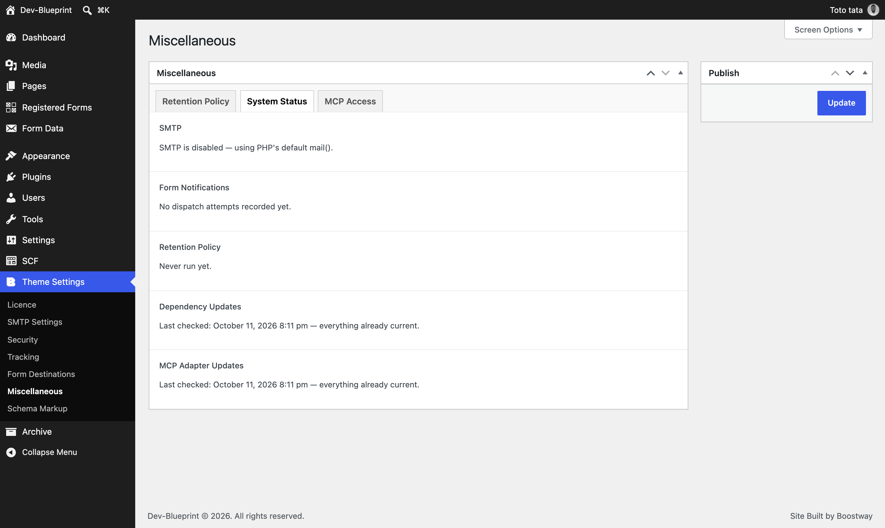
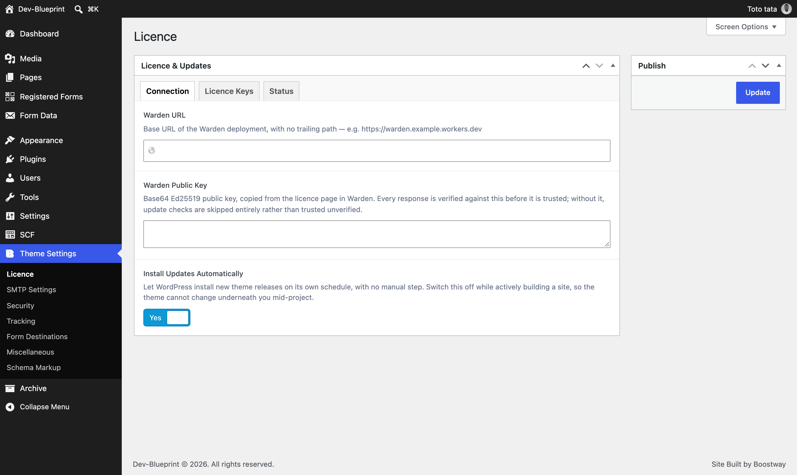
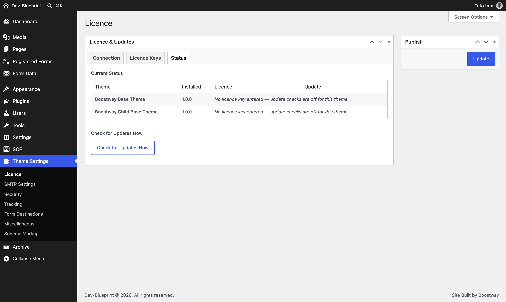
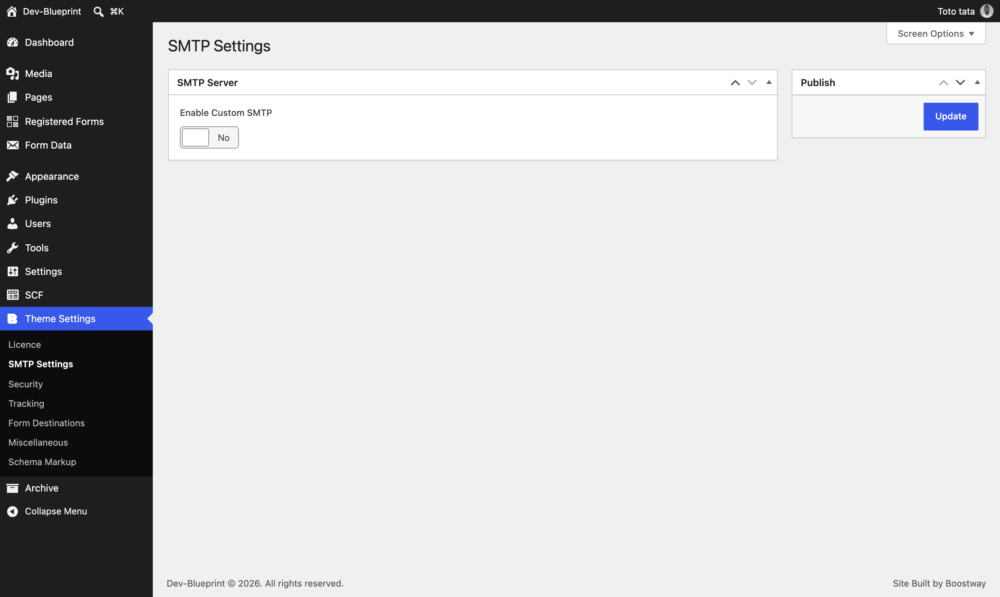
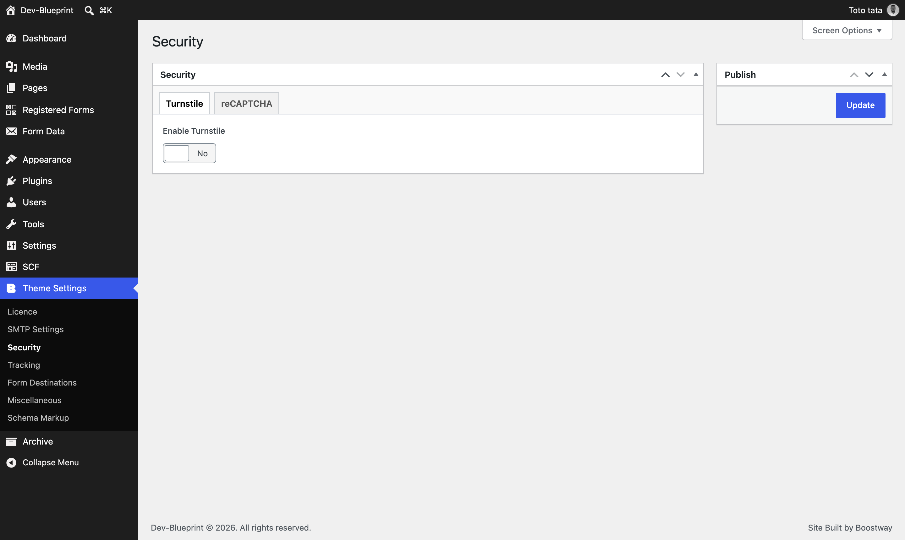
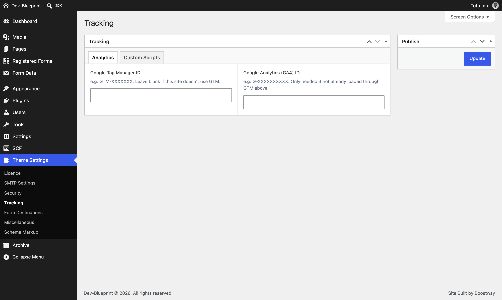
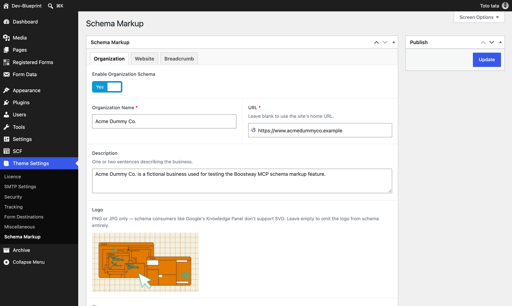
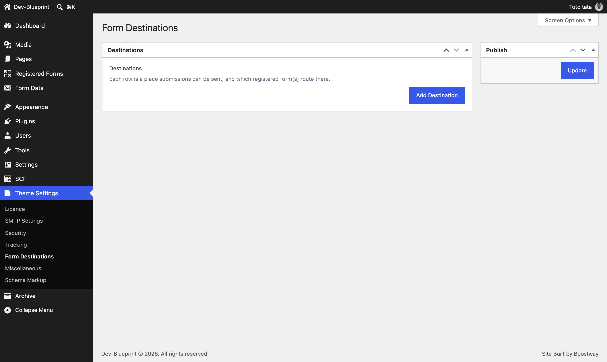
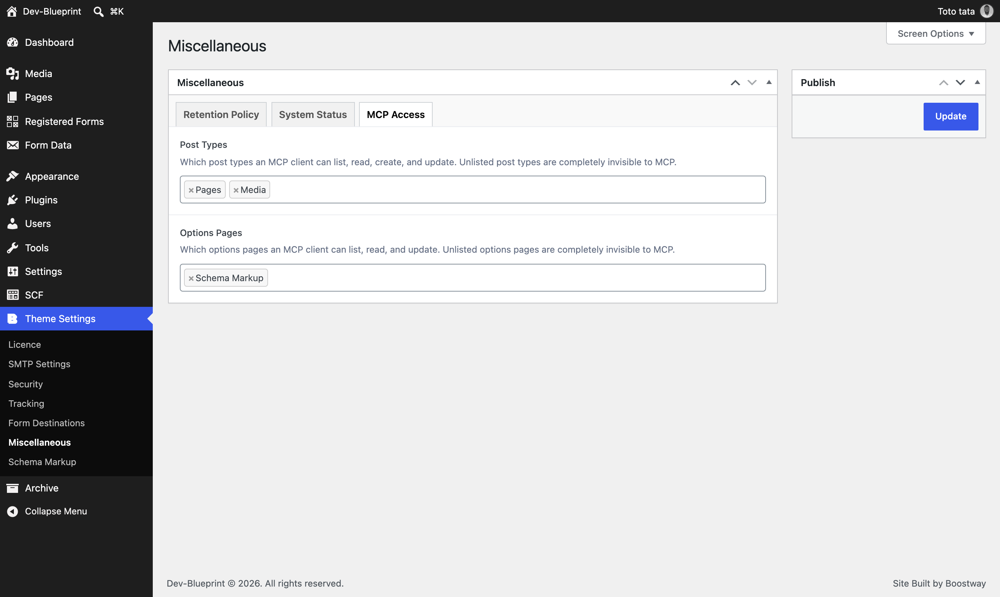

# Dev Base Parent Theme

The parent WordPress theme every client site is built on. It is
not a site in itself — it carries the functionality every project needs,
and each client runs a **child theme** on top of it holding only that
site's design and specifics.

Timber/Twig for templating, Secure Custom Fields for custom fields, Admin
Site Enhancements for admin cleanup and hardening — all vendored, none
installed as WordPress plugins.



---

## Why it exists

Agency WordPress work repeats the same problems on every project: routing
mail through real SMTP, gating forms behind a CAPTCHA, logging submissions
somewhere an admin can read them, emitting valid schema.org markup,
wiring up analytics, keeping dependencies patched. Rebuilding that each
time is waste; copying it between projects means every fix lives in one
site and dies there.

This theme is that work, written once, delivered as a parent theme so a
fix reaches every client site through a single release.

## What's in it

| Area | What it does |
| --- | --- |
| **Forms** | Two CPTs (`registered_form`, `form_data`), a JSON registry, automatic submission logging and dispatch to email/webhook destinations. A form author calls three functions and gets CSRF, CAPTCHA gating, logging and notifications. |
| **SMTP** | Real SMTP transport with a "Send Test Email" button that surfaces the actual PHPMailer error, not a generic failure. |
| **Security** | Cloudflare Turnstile or Google reCAPTCHA v2, mutually exclusive and enforced server-side. Forms call one function and never learn which is active. |
| **Tracking** | GTM/GA4 IDs plus raw header/footer script fields. |
| **Schema** | Organization, Website and Breadcrumb JSON-LD, each independently toggleable. |
| **Archives** | Custom fields on a CPT archive (which ACF has no location rule for) and CPT archives in the internal link picker. |
| **MCP** | Content abilities over the WordPress MCP Adapter — list/get/create/update posts and options values, generic across every post type, behind an opt-in allow-list. |
| **Updates** | Vendored dependencies track upstream on a daily schedule; both themes update themselves from a licensing service. |

## Installing

1. Install this theme into `wp-content/themes/`. **Do not rename the
   directory** — a child theme binds to it by exact name.
2. Install a child theme and activate **that**, not this one. The
   [Dev Base Child Theme](../wp_devbase_child_theme) is the
   starter to copy.
3. Fill in Theme Settings as the site needs.

WordPress refuses to activate a child whose parent is missing, so a wrong
install order produces a clear message rather than a broken site.

### Requirements

- WordPress 7.1+ (the Abilities API the MCP features build on)
- PHP 8.2+ (Timber 2.x's own requirement)

## Settings

Everything lives under **Theme Settings** in wp-admin. Every field is
registered in code, so it is identical on every site running this theme.

### Licence & updates



The endpoint, signing key and one licence key per theme. Leave a key empty
and that theme simply never checks for updates.



The Status tab answers "is this site actually receiving updates" — a
question that otherwise has half a dozen indistinguishable failure modes.
**Check for Updates Now** forces every check immediately rather than
waiting out the daily schedule.

### SMTP



Connection fields stay hidden until the feature is switched on, and are
only required while it is — ACF skips validation for conditionally hidden
fields, so "required when enabled" needs no custom JavaScript.

### Security



Turnstile and reCAPTCHA on separate tabs. Only one may be active; a
server-side `acf/validate_save_post` handler enforces that, with the
JavaScript toggle being a convenience that proves nothing.

### Tracking



### Schema markup



Three types, deliberately — the ones nearly every site needs and that are
cheap to build well. Anything industry-specific belongs in that project's
child theme.

### Form destinations



One repeater where each row is a self-contained destination (email or
webhook) plus the forms it applies to.

### MCP access



**Opt-in, always.** Nothing is readable or writable through MCP until an
admin explicitly ticks it here. A newly registered post type starts fully
locked down.

## The front end

This theme ships exactly one template — a branded placeholder, so a fresh
install shows something intentional rather than a blank page.


Real templates are the child theme's job, since they are the part every
project replaces. Timber resolves templates child-first, so a child's
`views/index.twig` takes over automatically.

## Extending it from a child theme

A child theme adds what it needs and inherits the rest. It never copies or
forks parent code.

```php
// Keep the blog on this client's site.
add_filter( 'devbase/admin_menu/hidden_items', function ( $items ) {
    return array_diff( $items, array( 'edit.php', 'edit-comments.php' ) );
} );

// This client's forms.
add_filter( 'devbase/forms/registered_forms', function ( $forms ) {
    $forms[] = array( 'name' => 'contact_form', 'label' => 'Contact Form' );
    return $forms;
} );
```

| Filter | Purpose |
| --- | --- |
| `devbase/ase/defaults` | Adjust an admin-hardening default. Fills gaps only — a value the site has already saved wins. |
| `devbase/ase/enforced` | Adjust it authoritatively. Reasserted on every admin page load. |
| `devbase/forms/registered_forms` | Register this site's forms. |
| `devbase/admin_menu/hidden_items` | Change which admin menu items are hidden. |
| `devbase/schema/tabs` | Contribute an extra schema.org type. |
| `devbase/updates/tracks` | Override update track detection (rarely needed). |
| `devbase/consent/stylesheet_url` | Reserved for consent integrations. |

**One rule.** WordPress loads a child's `functions.php` *before* the
parent's, so no parent function exists yet while it runs. Register filters
at the top level — they only store a callable. Never *call* a `devbase_*`
function there, and never guard one with `function_exists()`: it will be
false, the code will silently do nothing, and the cause is not obvious.

## Versioning

The `Version:` header in `style.css` is the single source of truth.
WordPress reads it, the updater reports it, and the licensing service
compares against it to decide whether a release applies.

```bash
./bin/bump-version.sh patch    # 1.0.0 -> 1.0.1
./bin/bump-version.sh minor    # 1.0.0 -> 1.1.0
./bin/bump-version.sh 2.0.0    # explicit
```

A release built without bumping it reaches nobody — every site reports the
version being offered and correctly concludes there is nothing to do. The
script refuses to move the version backwards for the same reason.

## Packaging a release

```bash
./bin/build-zip.sh
```

Two gates run before a zip is produced:

1. **Version drift** — the vendored dependency versions on disk must match
   `composer.lock`. The zip's dependencies are rebuilt from the lock file,
   not copied from the working tree, so building while the two disagree
   would ship older code than sites already run.
2. **The test suite** — a zip is only produced from code that passes.

The result excludes `tests/`, `bin/`, development translation sources and
internal documentation.

## Tests

```bash
cd tests && composer install && cd ..   # once
php tests/vendor/bin/phpunit
```

Runs against a real WordPress install and a **separate** database — the
core test suite drops and recreates tables, so it must never point at a
site's real database.

## Contributing

Issues and pull requests are welcome. Please read [SECURITY.md](SECURITY.md)
before reporting anything security-related, and note that `tests/` is
expected to pass before a change is considered complete.

## Licence

GPL v2 or later — see [LICENSE](LICENSE). This is not a stylistic choice:
the theme bundles GPLv2+ code, so a non-GPL licence would conflict with
what it ships.
